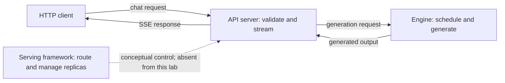
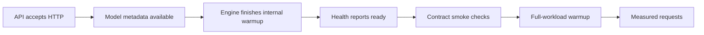

# Chapter 2: Building a Measurable LLM Service

This lab follows a request across the API contract into an inference engine,
then measures what the client actually receives. The portable implementation
and local HTTP checks pass. Both final engine runs completed all 144 measured
requests successfully: see the [matched comparison](artifacts/comparison-20260914/README.md).
Chapter manuscript prose and final conceptual figures are next.

The three responsibilities have different owners:



The initial lab uses vLLM's packaged API server and engine in a temporary Modal
Function. The HTTP client runs in that same container. There is no public
endpoint or serving-framework deployment. Measurements include the frontend
and loopback HTTP, but exclude Internet and laptop-to-cloud latency. Comparing
a second engine later means comparing complete serving setups under this
contract, with frontend differences acknowledged.

## Run the local checks

From the repository root:

```bash
uv sync --locked
uv run pytest chapters/02-building-a-measurable-llm-service/tests -q
```

The fixtures serve real loopback HTTP. They exercise fragmented UTF-8/SSE,
missing usage, malformed responses, disconnects, deadlines, cancellation,
worker limits, partial artifacts and hand-calculated throughput. They generate
synthetic text and provide no evidence about model or GPU performance.

## Measure an already running endpoint

Explain the question before changing the workload: do overlapping requests
change completion rate or delivery latency for this fixed set of short tasks?
[The configuration](experiment.json) contains 24 prompts, three paired repeats
at concurrency 1 and 4, and a full 24-request warmup pass before each condition. The
full schedule contains 291 generation requests, bounded by the declared cap of 300.
No failed request is retried automatically.

```bash
uv run python chapters/02-building-a-measurable-llm-service/code/experiment.py \
  --base-url http://127.0.0.1:8000/v1 \
  --config chapters/02-building-a-measurable-llm-service/experiment.json \
  --output artifacts/tmp/chapter02-endpoint
```

Choose a fresh output directory. The endpoint must serve the configured model
and pass both streaming and ordinary-response smoke checks with token usage.
The CPU preparation step in the Modal workflow also checks formatted prompt
lengths against the pinned tokenizer. When supplying your own endpoint, record
its actual model revision, tokenizer, launch controls and hardware alongside
the result; a model-name response alone does not verify these.

## Run the service on your own GPU host

The engine image or host environment must contain the selected vLLM release.
First run `prepare_model.py` with the configuration and a model directory; it
downloads the exact revision and validates formatted token lengths. Then use:

```bash
python chapters/02-building-a-measurable-llm-service/code/service.py \
  --config chapters/02-building-a-measurable-llm-service/experiment.json \
  --model-path /path/to/prepared-model \
  --output artifacts/tmp/chapter02-local-service
```

This starts the engine/API server, waits for readiness, measures, saves evidence
and tears down the process. It has no Modal dependency. Alternatively, launch
the engine yourself and use the endpoint-only client above.

Give this workflow exclusive use of port 8000. It checks that the loopback port
is available before launch, so an existing server cannot supply its readiness
response. Use an isolated container or reserve the port on your host; the check
does not coordinate other processes that try to launch at the same time.

## Run the same workflow through Modal

[The run specification](RUN_SPEC.md) declares the model, image, controls and
measurement boundary. Modal supplies compute, cached model files and artifact
transfer; it calls the same `serve_and_measure` function as the standalone
command. Importing the wrapper or running tests does not start remote compute.
The command below includes CPU preparation and a GPU measurement:

```bash
uv run modal run chapters/02-building-a-measurable-llm-service/code/modal_app.py \
  --output artifacts/tmp/chapter02-vllm-standard
```

The wrapper downloads the pinned model on CPU, checks prompt lengths, starts
one vLLM process on one L4, verifies readiness and disabled prefix caching,
runs the fixed workload, saves records/logs and stops the process. A failed
preparation does not proceed to GPU execution. Preparation and measurement
have separate deadlines, with no application retries. Remote interruption may
still occur; inspect Modal's run state and billing before considering another
attempt. Durable evidence is stored under the printed run ID in the
`inference-book-chapter-02-evidence` Volume and returned locally on normal exit.
A hard container termination can leave only records persisted before it ended.

## Read the evidence

For the Modal bundle, the terminal request records live in its `run/` directory:

```bash
uv run python chapters/02-building-a-measurable-llm-service/code/analyze.py \
  artifacts/tmp/chapter02-vllm-standard/run \
  --output artifacts/tmp/chapter02-analysis
```

For a direct endpoint run, pass the output directory itself. Analysis checks
request IDs and reconstructs stream text/timing from events before producing
`summary.csv` and `measurements.png`. Read per-repeat sample counts, failure
fractions and token-count coverage alongside speed. `completed` means the
schedule finished; it does not imply that every measured request succeeded.

Completion latency ends after the client accepts the terminal protocol marker
and closes the response context. It includes that local cleanup; it is not
exactly the arrival time of `[DONE]`. The terminal event records this boundary.

First-content latency starts at client submission and stops at the first
nonempty text event. Chunks are not tokens. Counted output throughput includes
only successful responses with server-reported usage and retains failed-request
time in its denominator. The optional output interval is a client-side
approximation, not engine inter-token latency. The five-second completion
threshold and output checks are teaching objectives, not a quality benchmark or
production SLO. A cancelled client socket does not establish engine cleanup;
the cancellation probe remains unverified without correlated server evidence.

See [artifact conventions](artifacts/README.md) and the
[validated vLLM/SGLang comparison](artifacts/comparison-20260914/README.md),
including repeat variation, actual output lengths and startup differences.
Larger models and deeper mechanism comparisons belong to later chapters.


## Compare saved runs

`compare.py` checks shared model, workload, hardware, execution mode, template
and observed prompt-count controls before generating a comparison CSV and
plot. Provide the two bundles' `run/` directories and a fresh output directory.
Read actual output lengths and per-repeat variation alongside token throughput.
Each engine includes its own API frontend and dependency versions.

The first short-warmup comparison exposed a slower first SGLang concurrent
repeat. Four uppercase requests were not representative of the explanation
tasks later measured. The current procedure warms up with the full workload;
this improves the experimental design without silently discarding observations
or claiming that warmup alone explains every timing difference.

Shutdown first signals the server parent, allowing it to drain its workers.
The process group is terminated forcibly only after the parent exits or its
shutdown deadline expires. A local subprocess test verifies cooperative child
cleanup. Remote logs and stopped-app state remain part of the evidence.


## Readiness is different from model metadata

In the selected SGLang release, `/v1/models` can answer while internal warmup
is still running. A real attempt hit the client's idle timeout at that boundary.
The service now waits on `/health`, with health-triggered generation disabled
for SGLang, and only then checks the Chat Completions contract. This preserves
the declared measured-request timeouts and avoids hidden generation in polling.



This ordering describes the observed SGLang startup case. Different servers
expose different readiness semantics; verify the chosen release rather than
assuming any successful HTTP response means inference is ready.


## Run the two misleading-result demonstrations

These examples need no GPU, model, credentials, or network. An in-process HTTP
fixture returns invented text and token usage through the real client. The
recorded elapsed times come from local execution and are not model performance.

```bash
uv run python chapters/02-building-a-measurable-llm-service/code/fixture_demo.py \
  --output artifacts/tmp/chapter02-fixtures
```

Read `demonstrations.json`. The first case returns `hello` in one content event;
the second returns the same text in five. Both report one fixture-defined token.
Treating content events as tokens multiplies the second case's rate by five.
The failure case retains one successful request and one deadline failure.
Compare its complete summary with the explicitly wrong summary that removes the
failed request. The wrong summary loses both a failure and time in the denominator.
Each case saves request records, protocol events, and clearly labelled metadata.

## Evidence checks added after the historical runs

Analysis now cross-checks usage, ordinary and streaming text, first and last
content times, finish reasons, terminal elapsed time, and output objectives.
Comparison additionally checks every prompt's phase, repeat, concurrency,
submitted controls, contract checks, warmups, and schedule identity.
Use `analyze.py --output` to write derived files away from preserved raw evidence.
The exact-text objective is case-sensitive after trimming surrounding whitespace.
All historical measured uppercase responses also pass this corrected check.

New service runs reject mismatched prepared model identity, template hashes and
workload hashes before engine launch. Both metric snapshots require successful
HTTP status and the engine's running/waiting request gauges. Failed observations
are saved separately. `outcome.json` distinguishes overall completion from
`experiment_status`, so a finished workload cannot hide a failed final observation.
Old bundles remain unchanged and retain their exact executed source.

Saved [synthetic demonstration evidence](artifacts/fixtures-20261115/README.md)
can be inspected without rerunning the fixtures.

To verify a complete GPU bundle without changing its original files:

```bash
uv run python chapters/02-building-a-measurable-llm-service/code/verify_bundle.py \
  chapters/02-building-a-measurable-llm-service/artifacts/vllm-20260914T044208Z \
  --output artifacts/tmp/chapter02-verified-vllm
```

This checks listed file hashes, executed source, model preparation, protocol
records, workload membership, output checks and required metric gauges. It
regenerates summaries and plots in the separate output directory. It does not
query live cloud state or establish engine cancellation from a closed socket.


The client is designed for the selected local engine APIs. Its streaming size
guards limit dispatched data payloads and retained events, not all incoming
comments/framing or HTTPX's unfinished line buffer. Request deadlines bound the
wait. This example is not a general client for untrusted streaming endpoints.
