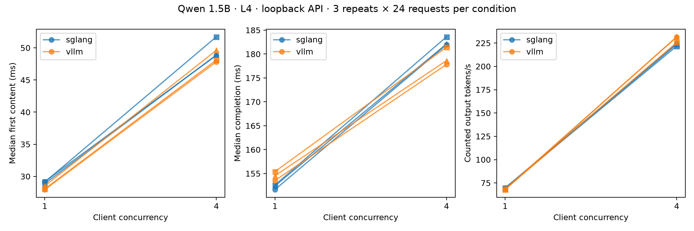

# Chapter 2: a matched vLLM/SGLang service comparison

Both final runs completed **144/144 measured requests** successfully. Each engine also completed 144 full-workload warmup requests and two smoke checks; its deliberate client cancellation is a separate probe. All Modal apps are stopped with zero tasks.

These measurements use Qwen2.5-1.5B-Instruct at revision `989aa7980e4cf806f80c7fef2b1adb7bc71aa306`, BF16, one L4 per engine, four CPU cores, 16 GiB host RAM and colocated loopback HTTP. Normal engine execution is enabled; prefix reuse is disabled. Every condition uses the same 24 prompts across three paired repeats, with a full warmup pass before each condition.

| Engine | Client concurrency | Median first content across repeats (ms range) | Median completion across repeats (ms range) | Requests/s range | Counted output tokens/s range |
| --- | --- | --- | --- | --- | --- |
| vLLM | 1 | 27.9–28.5 | 153.5–155.4 | 4.7–4.8 | 67.9–68.4 |
| vLLM | 4 | 47.8–49.6 | 177.8–181.4 | 15.8–16.1 | 225.7–231.7 |
| SGLang | 1 | 28.9–29.2 | 151.6–152.6 | 4.7–4.8 | 69.1–69.7 |
| SGLang | 4 | 48.8–51.7 | 182.0–183.6 | 15.0–15.2 | 221.8–224.7 |



Each line joins the two measured concurrency settings for one repeat; circle, square and triangle identify the repeats. No intermediate concurrency was measured. Latency columns report the range of the three per-repeat medians, not a confidence interval.

For this workload, both setups delivered roughly 4.7–4.8 successful requests/s at concurrency one. At concurrency four, vLLM delivered 15.8–16.1 requests/s and SGLang 15.0–15.2 requests/s. The major shared effect is the increase in completion rate with overlap, accompanied by longer first-content and completion latency. This small experiment does not establish an overall fastest engine.

## What was controlled and what still differs

The comparison program checked model revision, prompts, generation cap, repeat schedule, workload warmup, request deadlines, teaching objective, resources, topology, execution mode and chat-template hash. All observed prompt counts matched (37–44 tokens). Count coverage for successful measured output tokens is 100%; median output length was 10.5 tokens per condition, but actual outputs and total generated counts still differ.

vLLM 0.29.0 used Transformers 5.16.1; SGLang 0.5.19 used Transformers 5.12.1. Both images reported PyTorch 2.13.0+cu130 and HTTPX 0.28.1. API frontends, schedulers, graph strategies and internal memory allocation are engine-specific. The common 0.75 memory fraction and 64-request scheduler limit do not make their internals identical. This compares complete declared serving setups, not isolated kernels.

The final vLLM run used the earlier metadata startup check and passed smoke plus full workload warmup. The final SGLang run uses its readiness-aware health check after a reproduced startup race. All timed measurements start after readiness, contract checks and representative warmup. Startup-path differences remain disclosed rather than hidden.

## Failures that improved the example

- Modal initially could not identify the vLLM image’s interpreter. Adding an alias to the existing Python preserved the engine dependencies.
- The initial tokenizer precheck counted dictionary fields. Explicit token IDs, independent retokenization and a regression test corrected it without rewriting raw measurements.
- A short warmup did not represent the measured task mix. The final pair warms up with the whole workload and retains the earlier observations; it does not claim that warmup explains every difference.
- [The readiness race](../diagnostics/readiness-race/README.md) showed model metadata available before SGLang internal warmup finished. The fix uses readiness-aware health polling without loosening measured timeouts.
- Parent-first shutdown lets the engine drain workers before forced escalation. Engine warnings remain in raw logs; app teardown was verified independently.

## Reproduce the analysis

From the repository root:

```bash
uv run python chapters/02-building-a-measurable-llm-service/code/compare.py \
  chapters/02-building-a-measurable-llm-service/artifacts/vllm-20260914T044208Z/run \
  chapters/02-building-a-measurable-llm-service/artifacts/sglang-20260914T044837Z/run \
  --output artifacts/tmp/recomputed-comparison
```

Raw bundles: [vLLM](../vllm-20260914T044208Z/README.md), [SGLang](../sglang-20260914T044837Z/README.md). Their source snapshots match their recorded hashes. `comparison.csv` preserves every repeat; `comparison.json` records checked controls and limits.

No p99, production SLO, comprehensive quality score or universal engine ranking is claimed. The narrow output checks all passed. Client cancellation was observed; per-request engine resource reclamation remains unverified. TensorRT-LLM has not been run in this chapter.
