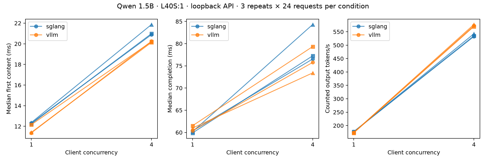

# Matched L40S serving-setup comparison

This current-source pair ran on 16 November 2026 UTC at commit
`2f4a4972bf7ab866fdf7f56ae09bc3f530911b37`:

- [vLLM vllm-20261116T065829Z](../vllm-20261116T065829Z/README.md)
- [SGLang sglang-20261116T070238Z](../sglang-20261116T070238Z/README.md)

Each setup completed 144/144 measured requests and 291 total generation requests.
Both used one L40S, four CPU cores, 16 GiB RAM, BF16 Qwen2.5-1.5B-Instruct at the
same pinned revision, the same chat-template hash and 24 fixed prompts. Each
concurrency condition had a full warmup and three alternating measured repeats.
The client and packaged API server shared the engine's container over loopback.
Prefix reuse was disabled; normal compilation and CUDA graphs remained enabled.

The observation compares complete serving setups. The packaged API frontends
and dependencies differ: vLLM 0.29.0 uses Transformers 5.16.1; SGLang 0.5.19
uses Transformers 5.12.1. Both report Torch 2.13.0+cu130 and HTTPX 0.28.1.
Equal memory fractions and sequence limits do not make engine policies identical.
The comparison validates declared controls and actual prompt counts; it does
not isolate one implementation mechanism.

## Results

Each row has 24 measured requests. Failure fraction is zero and token-count
coverage is complete in all rows. All 72 measured uppercase checks passed in
each setup; explanation prompts do not provide a general quality assessment.
First content and completion use the client clock. Completion includes response
cleanup. Output-token throughput divides server usage counts by the entire
measured condition window. Output lengths can differ between serving setups.

| Setup | Repeat | Concurrency | Successes | First content median (ms) | Completion median (ms) | Counted output tokens/s | Output tokens median [min–max] |
| --- | ---: | ---: | ---: | ---: | ---: | ---: | --- |
| vllm | 0 | 1 | 24/24 | 11.37 | 60.36 | 174.18 | 10.5 [3–30] |
| vllm | 0 | 4 | 24/24 | 20.25 | 75.78 | 572.48 | 10.5 [3–30] |
| vllm | 1 | 1 | 24/24 | 12.16 | 61.51 | 172.69 | 10.5 [3–30] |
| vllm | 1 | 4 | 24/24 | 20.20 | 79.34 | 569.82 | 10.5 [3–32] |
| vllm | 2 | 1 | 24/24 | 11.42 | 60.99 | 174.13 | 10.5 [3–30] |
| vllm | 2 | 4 | 24/24 | 20.14 | 73.41 | 577.34 | 10.5 [3–30] |
| sglang | 0 | 1 | 24/24 | 12.31 | 60.39 | 176.83 | 10.5 [3–31] |
| sglang | 0 | 4 | 24/24 | 20.89 | 76.54 | 532.72 | 10.5 [3–31] |
| sglang | 1 | 1 | 24/24 | 12.24 | 59.90 | 177.32 | 10.5 [3–31] |
| sglang | 1 | 4 | 24/24 | 20.99 | 77.26 | 534.85 | 10.5 [3–31] |
| sglang | 2 | 1 | 24/24 | 12.37 | 60.17 | 177.05 | 10.5 [3–31] |
| sglang | 2 | 4 | 24/24 | 21.87 | 84.32 | 542.60 | 10.5 [3–31] |



Concurrency four increases aggregate output-token throughput in this workload,
while median first-content latency increases. These observations support a
workload-specific tradeoff, not a universal engine ranking. Three short repeats
do not establish stable tail latency, production capacity or scaling efficiency
for larger models. Queue snapshots and closed client streams do not establish
per-request engine cancellation. TensorRT-LLM was not run.

## Reproduce from saved records

```bash
uv run python chapters/02-building-a-measurable-llm-service/code/compare.py \
  chapters/02-building-a-measurable-llm-service/artifacts/vllm-20261116T065829Z/run \
  chapters/02-building-a-measurable-llm-service/artifacts/sglang-20261116T070238Z/run \
  --output artifacts/tmp/comparison-current
```

See each bundle for GPU commands and offline verification. Derived CSV/JSON
values can be reproduced; new measurements and rendered PNG bytes can vary.
Raw outcomes, observations and source snapshots remain in the engine bundles.
Both apps were observed stopped with zero tasks and no live containers. Actual
billed spend was unavailable. Two preceding L4 calls stopped while queued and
produced no GPU measurements. The September L4 pair remains separate historical
evidence, not extra samples for this comparison.
