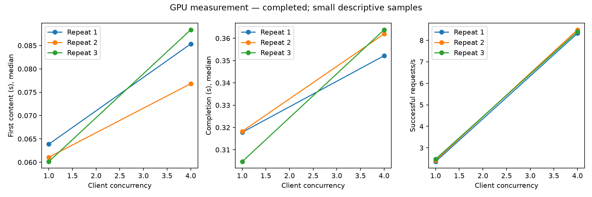

# Qwen 1.5B on vLLM 0.29.0 — first validated run

Run `vllm-20260914T041032Z` completed on 13 September 2026 (PDT). One NVIDIA L4, BF16, eager execution, prefix caching disabled. Client and API server shared the Modal container; Internet latency is excluded.

All 144 measured requests succeeded. The 24 warmups and two smoke requests also succeeded; the one deliberate cancellation is separate. Each table row contains 24 measured requests.

| Repeat | Concurrency | Median first content (ms) | Median completion (ms) | Requests/s | Counted output tokens/s |
| --- | --- | --- | --- | --- | --- |
| 1 | 1 | 63.9 | 317.8 | 2.36 | 33.76 |
| 1 | 4 | 85.3 | 352.2 | 8.32 | 118.97 |
| 2 | 1 | 61.1 | 318.3 | 2.42 | 34.62 |
| 2 | 4 | 76.8 | 362.0 | 8.49 | 121.34 |
| 3 | 1 | 60.1 | 304.7 | 2.48 | 35.43 |
| 3 | 4 | 88.4 | 363.8 | 8.41 | 119.08 |

Across these repeats, overlapping four requests increased successful completion rate by roughly 3.4–3.5 times while raising median first-content and completion latency. This supports a workload-specific concurrency lesson; it does not establish production capacity or a ranking against another engine.



## Validation and correction

All stream text and first-content timestamps were reconstructed from saved events. Server-reported output counts were available for every successful measured request. Median output length was 10.5 tokens in each condition, but actual outputs were not forced to equal length.

Post-run review found a preparation bug: `len(apply_chat_template(...))` counted the two fields of a `BatchEncoding` because Transformers 5 defaults to `return_dict=True`. The erroneous preparation counts remain in the original manifest. **Use [prompt-validation.json](prompt-validation.json) for corrected counts.** Retokenization using the exact cached tokenizer files and matching chat-template hash gave 37–44 tokens and agreed with all 144 measured server usage counts. Every prompt was below the declared 256-token cap. The code now explicitly requests a flat ID sequence and has a regression test. No GPU rerun was needed to establish these input lengths; the measured timings and server-reported counts are unchanged.

The cancellation record proves that the client stopped reading; it does not prove when the engine reclaimed resources. Server logs show orderly API shutdown and termination of the engine process, including a force-kill of a remaining engine worker and a semaphore cleanup warning. Modal subsequently reported the app stopped with zero tasks.

## Reproduce and inspect

From the repository root, regenerate analysis without a GPU:

```bash
uv run python chapters/02-building-a-measurable-llm-service/code/analyze.py \
  chapters/02-building-a-measurable-llm-service/artifacts/vllm-20260914T041032Z/run
```

The original paid command used `modal run chapters/02-building-a-measurable-llm-service/code/modal_app.py --output artifacts/tmp/chapter02-vllm-second` with the repository Python environment. Follow the current chapter run specification when reproducing the experiment.

`source/` preserves the exact executed chapter code and configuration; all file hashes match the source manifest. The working code contains the subsequent prompt-count correction. `run/` contains the untouched raw records plus regenerated summaries. `server.log`, metrics snapshots, `modal-console.log`, `launch.json`, `outcome.json` and `validation.json` retain supporting evidence.

App: `ap-7Zaxd3QFpeNn4SFjvapUWb`. The experiment itself took 40.83 seconds, excluding model preparation and server startup. The final dashboard charge has not been verified. Never interpret the 40.83-second client duration as the full billed GPU duration.

Each condition has a small descriptive sample. These runs do not establish p99 latency, a production SLO, comprehensive output quality, CUDA-graph performance or a cross-engine comparison. SGLang remains unrun.
