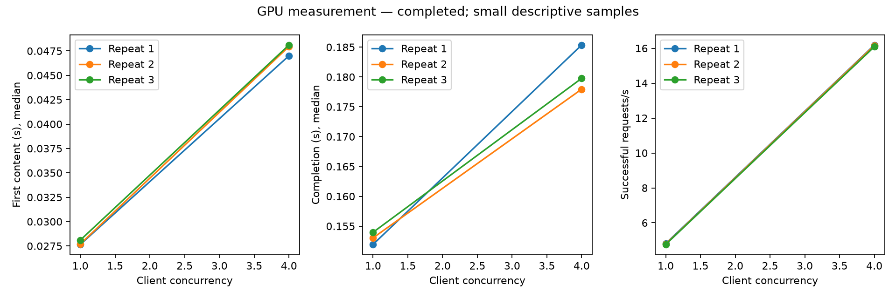

# Representative vLLM service: Qwen 1.5B on one L4

Run `vllm-20260914T042253Z`, 13 September 2026 (PDT). vLLM 0.29.0, BF16, L4, four CPU cores, 16 GiB host RAM, context 1024, sequence limit 64 and prefix caching disabled. Normal engine compilation and CUDA graph capture are confirmed by the saved server log. Client/API loopback latency excludes Internet transport.

All 144 measured requests succeeded; two smoke requests and 24 warmups succeeded, and the one deliberate cancellation remains a separate probe. Every measured prompt count agrees with CPU preparation (37–44 tokens). Saved stream text and first-content times reconstruct correctly. Each row below contains 24 measured requests.

| Repeat | Concurrency | Median first content (ms) | Median completion (ms) | Requests/s | Counted output tokens/s |
| --- | --- | --- | --- | --- | --- |
| 1 | 1 | 27.7 | 151.9 | 4.81 | 69.16 |
| 1 | 4 | 47.0 | 185.4 | 16.19 | 235.37 |
| 2 | 1 | 27.7 | 153.0 | 4.78 | 68.75 |
| 2 | 4 | 48.0 | 178.0 | 16.16 | 234.97 |
| 3 | 1 | 28.1 | 154.0 | 4.76 | 68.42 |
| 3 | 4 | 48.1 | 179.8 | 16.09 | 233.95 |



At concurrency four, completion throughput was about 3.4 times the concurrency-one value, with higher first-content and completion latency. These short requests and small samples demonstrate the trade-off without establishing production capacity. Output token usage coverage was 100%; actual output lengths remain in the raw records.

## Reproduction and evidence

The executed code and configuration are preserved under `source/`; all source hashes match the run manifest. The current service supports both engines explicitly, while this snapshot contains the vLLM-only portable workflow as executed. From the repository root, regenerate analysis:

```bash
uv run python chapters/02-building-a-measurable-llm-service/code/analyze.py \
  chapters/02-building-a-measurable-llm-service/artifacts/vllm-20260914T042253Z/run
```

The original invocation was `modal run chapters/02-building-a-measurable-llm-service/code/modal_app.py --output artifacts/tmp/chapter02-vllm-standard`, using the project Python environment. See the current chapter run specification for the portable host command and Modal adapter.

App `ap-4pZyTgQehuhstNneTDaCep` stopped at 21:26:35 PDT with zero tasks. The server log records shutdown. Final dashboard charges were not verified. Client measurement duration excludes image preparation, container startup, compilation and warmup.

## Limits

This is a complete serving-setup measurement, including the API frontend, not isolated kernel performance. The earlier eager-mode run used different CPU and scheduler settings as well as different execution mode; do not interpret their difference as a controlled CUDA-graph comparison. Cancellation demonstrates client closure; engine resource reclamation remains unverified. Exact-uppercase and nonempty-output checks are narrow teaching checks, not a quality benchmark. Three sequential repeats do not establish p99 or robust production tail estimates.
